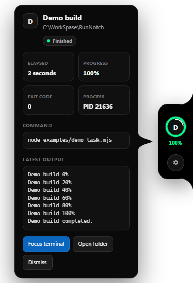

# RunNotch

> Your builds, tests, scripts, and AI agents — one glance away.

RunNotch is a local-first Windows desktop utility that lives on the right edge of the screen. Wrap a command with `runnotch`; its progress, output, duration, and exit status stay visible without reopening the terminal.



## What works in v0.1

- Always-on-top edge tab that reveals every run on hover or keyboard focus, then collapses when you leave.
- Live progress detection from percentages and `current/total` output.
- Running, needs-attention, stopping, success, failure, and interrupted states.
- A hover and keyboard-focus card with the command, working directory, duration, PID, exit code, and recent output.
- Native success/failure notifications.
- Best-effort return to the source terminal, with the working folder as a safe fallback.
- Explicit confirmation before stopping a process tree.
- Launch with Windows by default, configurable alongside notifications, sound, and finished-run retention.
- Local authenticated IPC on `127.0.0.1`; no account, cloud service, analytics, or telemetry.
- Common API keys, bearer tokens, credentials in URLs, and secret assignments are masked before UI logs are stored.
- Reduced-motion support and keyboard-focus parity with hover.

## Quick start from source

Requirements:

- Windows 10 or Windows 11.
- Node.js 20 or newer.

```powershell
cd C:\WorkSpase\RunNotch
npm.cmd install
npm.cmd link
npm.cmd start
```

Open a second terminal and run:

```powershell
runnotch npm test
```

Try the included visual demo:

```powershell
runnotch --name "Demo build" -- node examples/demo-task.mjs
```

RunNotch starts the desktop app automatically when the linked CLI can find the local Electron runtime.

## CLI

```text
runnotch [options] -- <command> [arguments]
runnotch [options] <command> [arguments]
```

| Option | Meaning |
|---|---|
| `-n, --name <name>` | Label shown in the notch |
| `-C, --cwd <path>` | Run from a different working directory |
| `--quiet` | Hide the child output in the current terminal; it still appears in RunNotch |
| `--no-app` | Do not start the desktop app automatically |
| `-h, --help` | Show help |
| `-v, --version` | Show version |

Examples:

```powershell
runnotch npm run build
runnotch --name "API tests" -- npm test
runnotch -C .\web npm run dev
runnotch -- python train.py
runnotch -- docker compose up
```

RunNotch executes the command directly. Shell built-ins should be made explicit:

```powershell
runnotch cmd.exe /c dir
runnotch powershell.exe -NoProfile -Command "Get-ChildItem"
```

## Status language

| State | Ring | Label |
|---|---|---|
| Running with progress | Blue progress | Percentage |
| Running without progress | White inner activity arc | Elapsed time |
| Needs attention | Yellow pulse | `WAIT` |
| Finished | Green full ring | `DONE` or `100%` |
| Failed | Orange-red ring | `FAIL` |
| Interrupted | Orange-red ring | `LOST` |

Attention detection currently recognizes conventional prompts such as `[y/n]`, `Press Enter`, `waiting for approval`, and `requires permission`.

## Build a Windows package

Portable executable:

```powershell
npm.cmd run pack:win
```

Installer and portable executable:

```powershell
npm.cmd run dist:win
```

Artifacts appear in `dist/` as `RunNotch-Setup-*` and `RunNotch-Portable-*`. Unpacked and installed builds include `runnotch.cmd` beside `RunNotch.exe`. Add that installation folder to `PATH`, or invoke the shim by its full path:

```powershell
& "$env:LOCALAPPDATA\Programs\RunNotch\runnotch.cmd" npm test
```

The installer launches RunNotch when setup finishes. RunNotch then registers itself to start automatically when you sign in to Windows. You can turn this off at any time from **RunNotch settings → Launch with Windows**.

Code signing is not configured. Windows SmartScreen may warn about unsigned release artifacts; public releases should be signed before broad distribution.

## Publish a GitHub release

Push the source once, then create a version tag:

```powershell
git push -u origin main
git tag v0.2.0
git push origin v0.2.0
```

The release workflow runs the tests, builds fresh Windows packages, generates SHA-256 checksums, and publishes the installer and portable executable to a GitHub Release automatically.

## Architecture

```text
runnotch CLI
├── starts the requested child command
├── preserves stdout/stderr in the terminal
├── detects progress and attention locally
└── sends redacted events over authenticated localhost IPC
          ↓
RunNotch desktop process
├── validates and persists bounded state
├── draws the transparent edge UI
├── sends native notifications
└── performs explicit user actions such as focus/open/stop
```

Important files:

```text
cli/runnotch.mjs       CLI wrapper and output reporter
src/main.cjs           Electron lifecycle, IPC server, tray, notifications
src/store.cjs          Persisted job state and retention
src/protocol.cjs       Event contract, progress detection, secret masking
src/preload.cjs        Narrow renderer bridge
src/ui/                Accessible HTML/CSS/JavaScript interface
tests/                 Node test suite
```

The UI renderer has no Node.js access. It communicates through a narrow, context-isolated preload API. The localhost event server requires a random 256-bit bearer token stored in the user configuration directory.

## Local data

On Windows, RunNotch stores its state under:

```text
%APPDATA%\RunNotch\
├── ipc-token
└── state.json
```

The UI keeps at most 120 recent output lines per run and truncates each stored line. RunNotch does not intentionally store environment variables or stdin. Command arguments can themselves contain sensitive values, so the built-in masker is defense-in-depth rather than a guarantee; prefer environment variables or secret files over command-line secrets.

## Development checks

```powershell
npm.cmd test
npm.cmd run check
npm.cmd audit --omit=dev
```

## Roadmap

- Bash, Zsh, and PowerShell hooks for automatic long-command detection.
- Exact Windows Terminal, iTerm2, Terminal.app, and tmux pane focusing.
- User-defined progress adapters for pytest, Cargo, Gradle, Docker, and AI agents.
- macOS edge implementation.
- Run history and duration baselines.
- Signed installers and package-manager releases.

See [CONTRIBUTING.md](CONTRIBUTING.md) for contribution guidance and [SECURITY.md](SECURITY.md) for private vulnerability reporting.

## License

MIT
